# EQC Activities Hub

Every EQC classroom game, activity and Bootstrap clone site in one place.

The home page is the **trainer's big screen**: put it on the projector (or share it on the call), and students join each game from their phones by scanning a QR code. No student logins, no apps to install.

**Live:** https://eqc-activities-hub.vercel.app

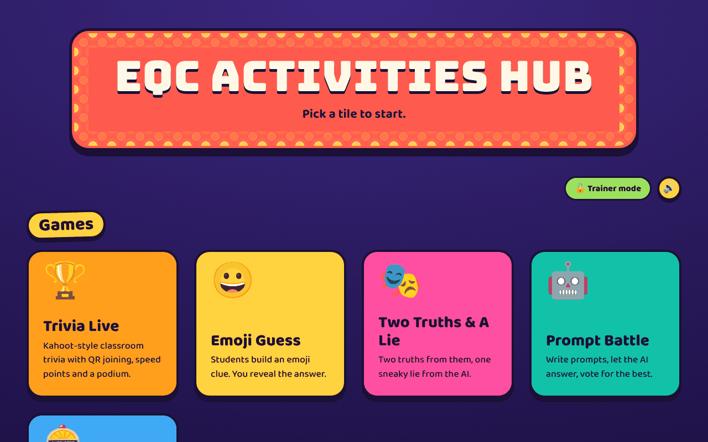

## Contents

- [How a class session works](#how-a-class-session-works)
- [The games](#the-games)
  - [🏆 Trivia Live](#-trivia-live)
  - [📌 The noticeboard: Emoji Guess and Two Truths & A Lie](#-the-noticeboard-emoji-guess-and-two-truths--a-lie)
  - [🤖 Prompt Battle](#-prompt-battle)
  - [🎰 Name Picker (slot machine or claw)](#-name-picker-slot-machine-or-claw)
- [Trainer PIN](#trainer-pin)
- [Bootstrap clone sites: get one on your computer](#bootstrap-clone-sites-get-one-on-your-computer)
- [Other class activities](#other-class-activities)
- [How it's built](#how-its-built)
- [Run it, test it, deploy it](#run-it-test-it-deploy-it)

---

## How a class session works

1. Open **https://eqc-activities-hub.vercel.app** on the computer connected to the projector.
2. Click a game tile. A big **QR code** and short link appear.
3. Students scan it with their phone camera (or type the link) and play on their phones. Everything they send shows up live on the big screen.
4. Buttons that change things for everyone ask for the [trainer PIN](#trainer-pin) the first time.

Online class? Share the home page on the call. Every QR code also shows a short link and a 4-letter code that students can type.

The 🔊 button in the top corner mutes all music and sound effects.

---

## The games

### 🏆 Trivia Live

Kahoot-style quiz. Students answer on their phones, scoring speed points and keeping streaks.

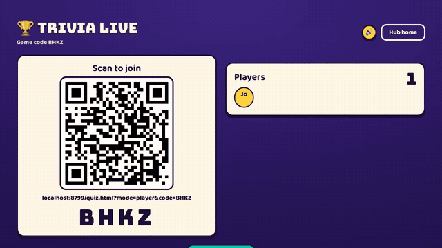

**Running it**

1. Click **Trivia Live**.
2. Pick up to 5 categories, the number of questions (5, 10, 15 or 20) and the time per question (20, 30 or 60 s).
3. Click **Start lobby**. Students scan the QR code and their names pop up on screen.
4. Click **Start game**. Each question:
   1. A 3-2-1 countdown plays, then the question goes up with four coloured answer shapes.
   2. Students tap their answer.
   3. When everyone has answered, or time runs out, the answer bars reveal who picked what.
5. Click **Leaderboard** to see the scores slide into place, then **Next question**.
6. The end shows a podium revealed 3rd → 2nd → 1st, with fanfare and confetti.

| Setup | Lobby |
|---|---|
| 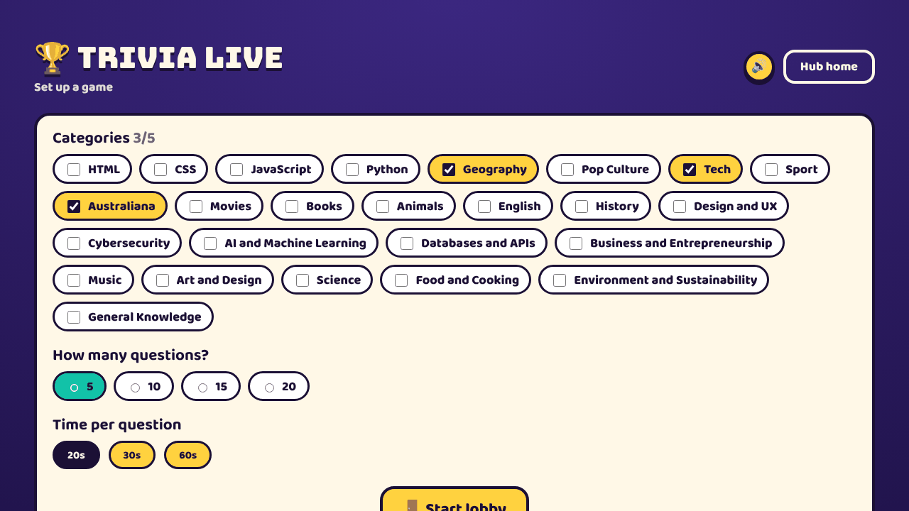 | 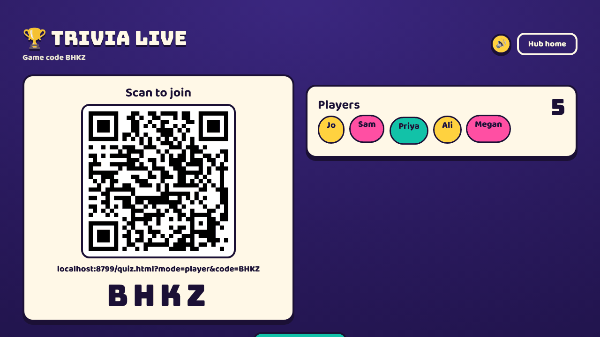 |

On students' phones:

<p>
  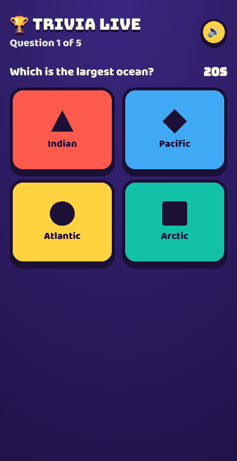
  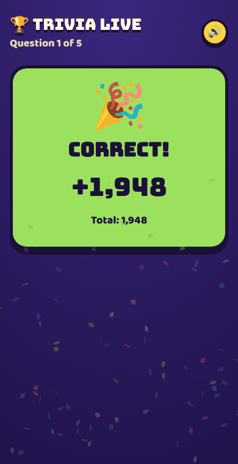
  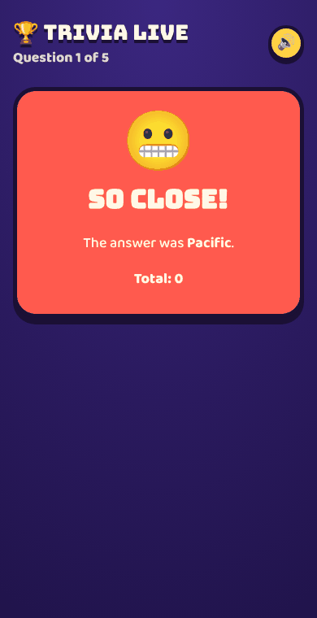
</p>

---

### 📌 The noticeboard: Emoji Guess and Two Truths & A Lie

The noticeboard is always on the home page. Students post to it from their phones, and you reveal the answers one card at a time.


**Running it**

1. Click the **Emoji Guess** or **Two Truths** tile (or the QR buttons above the board).
2. Students scan the QR code and post. Cards pin themselves to the board as they arrive, with the newest first.
3. Click a card to blow it up for the projector. The class guesses out loud.
4. Click **✨ Reveal** to flip it:
   - **Emoji Guess** shows the answer.
   - **Two Truths** stamps the lie **LIE!** and the others **TRUE**.
5. Use **🧹 Clear board** at the start of a new class.

These QR codes never change, so you can put them on a slide:

| Game | Student link |
|---|---|
| Emoji Guess | `/class-games/emoji.html` |
| Two Truths & A Lie | `/class-games/truths.html` |

**😀 Emoji Guess on a phone.** Students pick a category, type the secret answer, and build the clue with the **＋ Add emoji** button. It opens the full emoji set with search, so no keyboard typing is needed.

<p>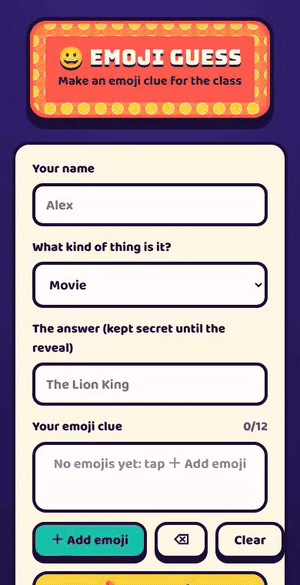</p>

**🎭 Two Truths & A Lie on a phone.** Students write two true things about themselves. The **AI writes a believable lie in the same style** (same length, tone, even lowercase if they type that way). It stays secret, even from them, until you reveal it. If the AI is ever unavailable, a built-in bank of ordinary-sounding lies is used, so it always works.

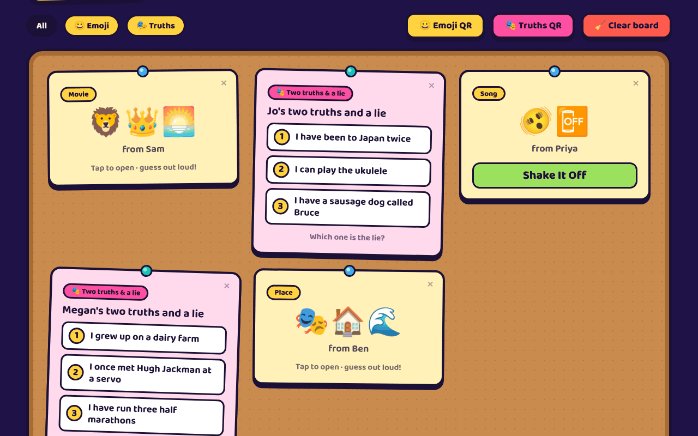

---

### 🤖 Prompt Battle

A prompt-writing game. You set a challenge, students write prompts on their phones, the AI answers each one, and the class votes for the best answer. The reveal shows the winner **and the prompt that made it**, which is the teaching moment.

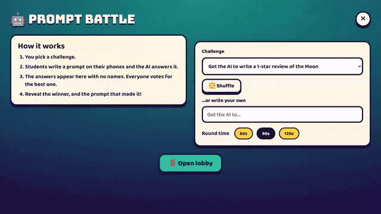

**Running it**

1. Click **Prompt Battle**.
2. Pick a challenge (there are 30+ built in; 🔀 shuffles), or write your own, and choose 60, 90 or 120 seconds.
3. Click **Open lobby**. Students scan in and their names pop up.
4. Click **Start round**. Each student writes a prompt and taps **Try it** to see the AI's answer. They get up to 3 tries, then **Submit this one**.
5. Answers appear on the big screen with **no names**. You can hide any answer with its ✕.
6. Click **Start voting**. Everyone gives one ⭐ on their phone.
7. Click **Reveal winner**. A drumroll plays, then the winner, their prompt, and a leaderboard across rounds appear.
8. Click **Next round** for another challenge, or **🏁 End battle** for the podium. End battle works from any screen.

If you refresh or close the home page mid-game, the battle comes back where it was.

<p>
  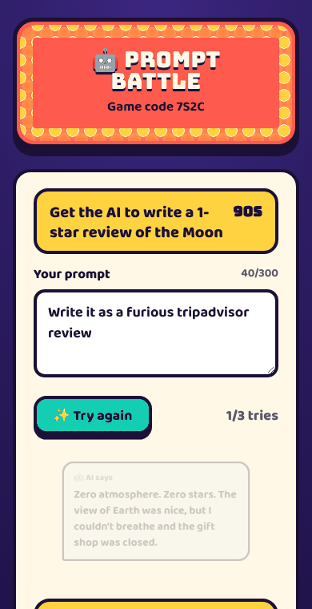
  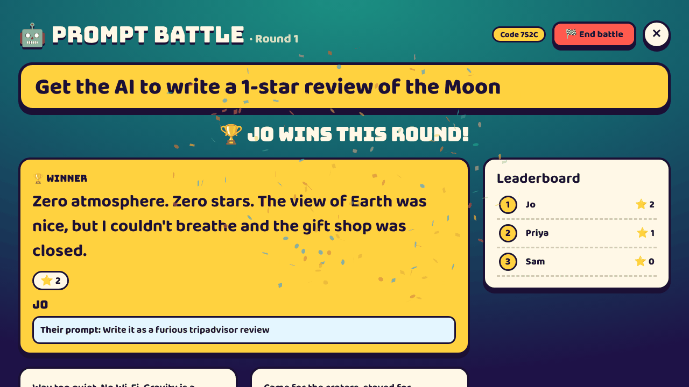
</p>

---

### 🎰 Name Picker (slot machine or claw)

Picks who answers the next question. It's on the home page under the noticeboard.

| 🎰 Slot machine | 🕹️ Claw machine |
|---|---|
| 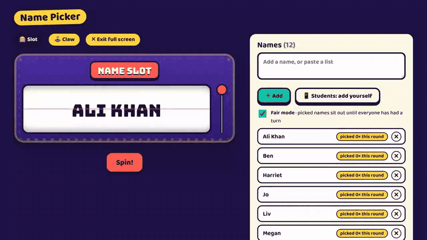 | 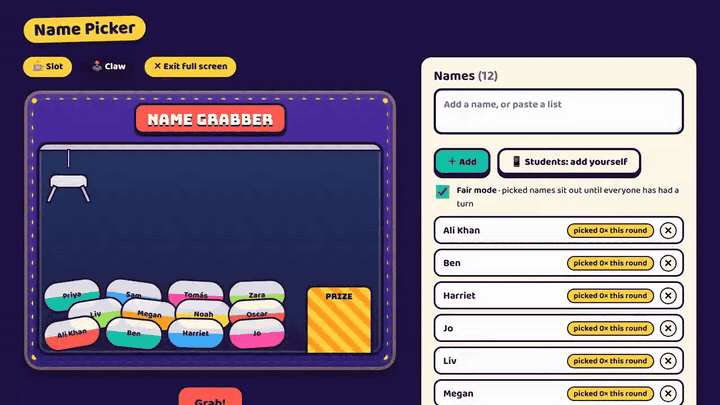 |

- **Add names:** type one, or paste the whole class list (one per line). Students can also add themselves with **📱 Students: add yourself**, which opens a QR code to `/class-games/picker.html`.
- **Spin! / Grab!** picks a name, plays the animation, and shows a "You're up!" banner.
- **Tally:** each name shows **picked N× this round**.
- **Fair mode** (on by default): picked names sit out until everyone has had a turn, then it starts again.
- **🔄 New round** resets the tallies. **⛶ Full screen** fills the projector.

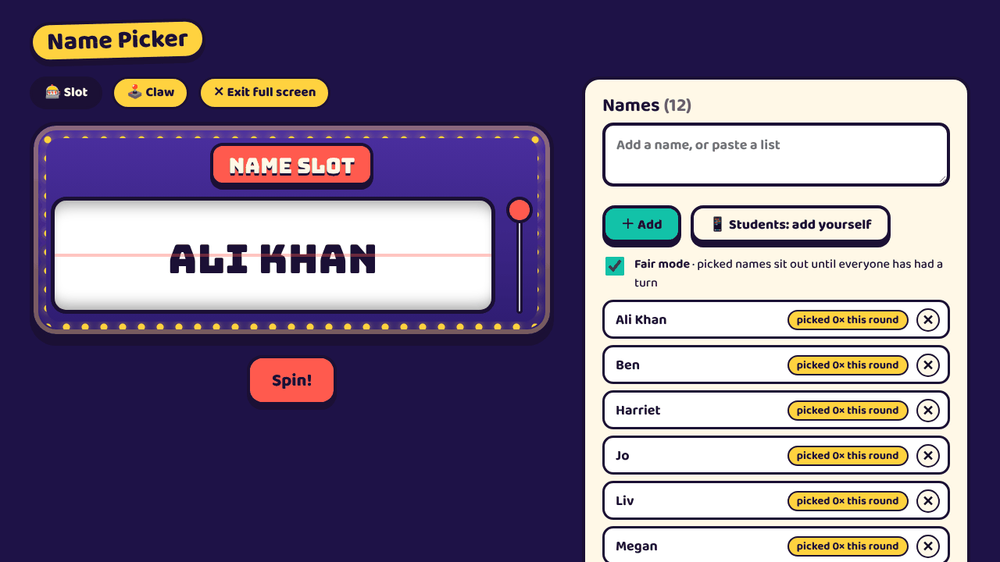

---

## Trainer PIN

Anything that changes things for everyone asks for a 4-digit PIN once per computer:

- Reveal, Clear board, deleting a card
- Spin, New round, removing names
- Starting and ending games, and opening the Trivia big screen

**The default PIN is `2468`.** The 🔒/🔓 chip on the home page shows whether this computer is unlocked; click it to lock again.

To change the PIN:

1. Open a terminal and run `printf 1234 | sha256sum` (with your new PIN instead of 1234).
2. Paste the long code it prints into `TRAINER_PIN_HASH` in [`assets/hub.js`](assets/hub.js).

It's a speed bump that stops a curious student clearing the board, not real security.

---

## Bootstrap clone sites: get one on your computer

| Site | What it is | See it live |
|---|---|---|
| 🍏 **Apple** | A multi-page Bootstrap 5 build, commented line by line | [/bootstrap-clone-apple/](https://eqc-activities-hub.vercel.app/bootstrap-clone-apple/) |
| 🩺 **nib Health** | Three pages of health cover layouts | [/bootstrap-clone-nib-health/](https://eqc-activities-hub.vercel.app/bootstrap-clone-nib-health/) |
| 🏝️ **Skywings Resorts** | A luxury travel site with destinations, packages and a blog | [/bootstrap-clone-skywings/](https://eqc-activities-hub.vercel.app/bootstrap-clone-skywings/) |
| 🌲 **Forbidden Forest** | The night-time forest trail experience, rebuilt in Bootstrap | [/bootstrap-clone-forbidden-forrest/](https://eqc-activities-hub.vercel.app/bootstrap-clone-forbidden-forrest/) |

### How to download one (students)

You need **Git** installed (check by typing `git --version` in a terminal).

1. Open **VS Code**.
2. Open a terminal: **Terminal → New Terminal** (or press ``Ctrl+` ``, or ``⌃` `` on a Mac).
3. Go to the folder where you keep your work, for example `cd Documents`.
4. Copy the commands for your site below, paste them into the terminal and press **Enter**. Run them one line at a time if you prefer.

The commands download **only that site's folder**, not the whole hub. They work in the Windows (PowerShell or Git Bash) and Mac terminals.

**🍏 Apple**

```bash
git clone --depth 1 --filter=blob:none --sparse https://github.com/thedalycreative/eqc-activities-hub.git apple-clone
cd apple-clone
git sparse-checkout set --no-cone bootstrap-clone-apple/
code bootstrap-clone-apple
```

**🩺 nib Health**

```bash
git clone --depth 1 --filter=blob:none --sparse https://github.com/thedalycreative/eqc-activities-hub.git nib-health-clone
cd nib-health-clone
git sparse-checkout set --no-cone bootstrap-clone-nib-health/
code bootstrap-clone-nib-health
```

**🏝️ Skywings Resorts**

```bash
git clone --depth 1 --filter=blob:none --sparse https://github.com/thedalycreative/eqc-activities-hub.git skywings-clone
cd skywings-clone
git sparse-checkout set --no-cone bootstrap-clone-skywings/
code bootstrap-clone-skywings
```

**🌲 Forbidden Forest**

```bash
git clone --depth 1 --filter=blob:none --sparse https://github.com/thedalycreative/eqc-activities-hub.git forbidden-forest-clone
cd forbidden-forest-clone
git sparse-checkout set --no-cone bootstrap-clone-forbidden-forrest/
code bootstrap-clone-forbidden-forrest
```

**What each line does**

| Line | What it does |
|---|---|
| `git clone … --sparse … apple-clone` | Makes a new folder called `apple-clone` and connects it to the hub, without downloading every file yet. `--depth 1` skips the history, so it's quick. |
| `cd apple-clone` | Moves into that new folder. |
| `git sparse-checkout set --no-cone bootstrap-clone-apple/` | Downloads just the site you want. |
| `code bootstrap-clone-apple` | Opens the site in a new VS Code window. |

**Tips**

- **`code` not found on a Mac?** In VS Code press `⌘⇧P`, run **Shell Command: Install 'code' command in PATH**, then try again. Or use **File → Open Folder…** and pick the site folder.
- **See it in your browser:** right-click `index.html` → **Open with Live Server** (install the *Live Server* extension first), or just double-click `index.html`.
- **Want everything at once?** `git clone https://github.com/thedalycreative/eqc-activities-hub.git` downloads the whole hub, all sites included.
- **Get the latest version later:** inside the clone folder, run `git pull`.

---

## Other class activities

| Folder | What it is | Path |
|---|---|---|
| `hiring-generator/` | Bootstrap Hiring Ceremony: hand out Bootstrap projects as a live reveal | [/hiring-generator/](https://eqc-activities-hub.vercel.app/hiring-generator/) |
| `yearbook-wall/` | Yearbook Wall icebreaker: students build a tile that pops up on the projector | [/yearbook-wall/build.html](https://eqc-activities-hub.vercel.app/yearbook-wall/build.html) |
| `quokka-careers/` | Quokka Careers: apply for ridiculous jobs, then roleplay the interview | [/quokka-careers/](https://eqc-activities-hub.vercel.app/quokka-careers/) |
| `flexbox-exercise/` | Flexbox practice: line up the boxes using nothing but flexbox | [/flexbox-exercise/](https://eqc-activities-hub.vercel.app/flexbox-exercise/) |

Each of these used to be a separate repo; its full commit history came across with it.

---

## How it's built

A plain static site: **HTML, CSS and vanilla JavaScript modules, with no build step and no framework**. It's deliberately close to what students are learning.

Live data goes through **Supabase**, and one small **Vercel Function** talks to the AI.

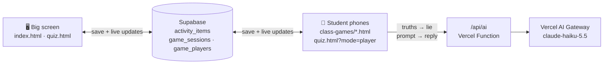

### What's where

| Path | What it does |
|---|---|
| `index.html`, `assets/home.js`, `assets/home.css` | The home page (big screen): game tiles, toolbar, and mounting the noticeboard, picker and battle |
| `assets/hub.css` | The shared game-show look every page uses: colours, fonts (Bungee + Baloo 2), chunky buttons, cards, pop-ups |
| `assets/hub.js` | Shared helpers: safe text (`esc`), trainer PIN, pop-ups, toasts, QR codes, confetti |
| `assets/sound.js` | Music and sound effects, all generated in the browser with the Web Audio API (no audio files) |
| `assets/noticeboard.js` | The noticeboard: cards, filters, spotlight, Reveal, Clear board |
| `assets/picker.js`, `assets/picker-logic.js` | The Name Picker (slot and claw animations) and its rules (fair mode, tallies, pasted lists) |
| `assets/battle-stage.js`, `assets/battle-logic.js` | The Prompt Battle big screen and its rules (rounds, votes, scores, the challenge list) |
| `quiz.html`, `assets/trivia-page.js`, `assets/trivia-logic.js`, `quiz-bank.js` | Trivia Live: the page, its scoring and leaderboard rules, and the question bank |
| `assets/lie-bank.js` | The backup lies used if the AI is unavailable |
| `class-games/*.html` | The student phone pages: `emoji`, `truths`, `battle`, `picker` |
| `api/ai.mjs` | The Vercel Function that asks the AI for a lie or a battle reply |
| `activity-store.js` | Reading, writing and live-listening to Supabase |
| `assets/vendor/` | Bundled libraries: QR codes (qrcode-generator), confetti (canvas-confetti), the emoji picker (emoji-picker-element) |

### Data

Everything lives in three Supabase tables (see `supabase-schema.sql`):

- `activity_items` is a simple key-value store: one row per card, name or answer, grouped by activity.
  - Noticeboard: `emoji`, `truths`
  - Name Picker: `picker`
  - One game of Prompt Battle: `battle-ABCD`
  - One game of Trivia: `quiz-ABCD`
- `game_sessions` and `game_players` hold the 4-letter game codes and who has joined.

Live updates use Supabase Realtime. Screens also re-read the data when a phone wakes up or reconnects, so nobody gets stuck on an old screen.

### The AI

`api/ai.mjs` calls **Vercel AI Gateway** using the deployment's own sign-in token, so **there's no API key to set up**.

- **Two Truths lie:** the AI is told to copy the student's length, tone, grammar and casing, and to stay plausible, not jokey.
- **Prompt Battle reply:** at most 60 words and classroom-appropriate; inappropriate prompts get a light-hearted refusal.
- **Limits:** inputs are capped (truths 160 characters, prompts 300) and replies are short, so a class session costs cents.
- **Optional settings** (Vercel → Settings → Environment Variables):
  - `AI_MODEL` swaps the model.
  - `AI_GATEWAY_API_KEY` uses a specific key.
- **If AI ever errors:** Vercel dashboard → **AI Gateway** → make sure it's enabled for the team.

### Old links

The old addresses still work and redirect to their new homes (see `vercel.json`):

| Old address | Now goes to |
|---|---|
| `/dashboard.html`, `/game-dashboard.html`, `/play.html` | The home page |
| `/slot-pick/` | The Name Picker on the home page |
| `/class-games/prompts.html` | Prompt Battle |

---

## Run it, test it, deploy it

### Run it locally

```bash
git clone https://github.com/thedalycreative/eqc-activities-hub.git
cd eqc-activities-hub
npx serve .
```

Everything works locally except the AI, which only runs on Vercel or with `vercel dev`.

### Tests

```bash
pip install pytest playwright && python3 -m playwright install chromium   # once
sh tests/run-all.sh
```

- **Unit tests** (`tests/unit`, using Node's built-in test runner) cover the game rules: scoring, fair mode, voting, lies, and the AI function's checks.
- **Browser tests** (`tests/e2e`) drive every page in headless Chrome.
  - They swap the real database for a fake one (`tests/e2e/fake-store.js`), so they never touch class data.
  - Coverage includes every game flow, odd or hostile text, the AI being down, double-taps, refreshing mid-game, re-scanning a QR code, and the real animations.

### Deploy

Push to `main` and Vercel deploys it (project **eqc-activities-hub**). Every branch or pull request also gets its own preview link.

### Add a new activity

1. Put the project in a new folder at the repo root.
2. Use **relative** links inside it (`styles.css`, `images/pic.jpg`), not root links (`/styles.css`), because the project is served from a subfolder.
3. Add a tile for it in `index.html`.
4. Push to `main`.

---

Made by [Tim Daly](https://thedalycreative.com) for EQC classes.
