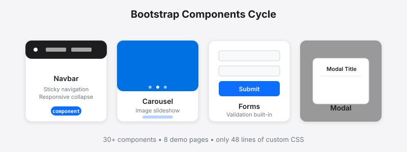

# 🍏 Apple Clone — Bootstrap Teaching Project

> **A complete, multi-page Bootstrap 5.3 teaching site styled like apple.com.au.**
> Every section is heavily commented and links to the official Bootstrap documentation
> so students can learn by reading the source.



<p align="center">
  
  
  
  
  
  
  
</p>

---

## 📖 Table of Contents

1. [What is this project?](#-what-is-this-project)
2. [What you'll learn](#-what-youll-learn)
3. [Pages overview](#-pages-overview)
4. [The 12-column grid (animated)](#-the-12-column-grid)
5. [Bootstrap colour palette](#-bootstrap-colour-palette)
6. [Components reference](#-components-reference)
7. [Setup & how to run](#-setup--how-to-run)
8. [Project structure](#-project-structure)
9. [Reading the code](#-reading-the-code)
10. [Your assignment](#-your-assignment)
11. [Resources](#-resources)
12. [Troubleshooting](#-troubleshooting)

---

## 🎯 What is this project?

This is a **multi-page Apple.com.au clone** built entirely with **Bootstrap 5.3**, designed as a teaching tool for the **Diploma of IT (Back End Web Development) — Subject 2: Front End Web Development**.


The goal is to demonstrate **how much you can build with as little custom CSS as possible** — the entire 8-page site uses only **48 lines of `styles.css`**, with everything else handled by Bootstrap's utility classes and components.

### What's a `README.md`?

A `README.md` is the front door of any code project — the first file people read. The **`.md`** extension stands for **Markdown**, a simple text-formatting language used everywhere in software (GitHub, GitLab, npm, Docker Hub, etc.).

📚 **New to Markdown?** Try the [interactive Markdown Tutorial](https://www.markdowntutorial.com/) — it takes 10 minutes.

---

## 🎓 What you'll learn

By reading and modifying this project, you'll understand:

- ✅ The **Bootstrap 5.3 grid system** — `container`, `row`, `col-*`, breakpoints
- ✅ **30+ Bootstrap components** — navbars, modals, carousels, accordions, forms…
- ✅ **Utility-first CSS** — spacing, colours, typography, flexbox helpers
- ✅ **Responsive design** — `xs`, `sm`, `md`, `lg`, `xl`, `xxl` breakpoints
- ✅ **Form validation** — built-in browser validation styled by Bootstrap
- ✅ **Bootstrap JavaScript** — `data-bs-toggle`, manual init for tooltips/popovers
- ✅ **Accessibility** — ARIA labels, semantic HTML, screen-reader text


---

## 📑 Pages overview

The site is broken into **8 pages** — each one focuses on a different family of Bootstrap components so you can learn one topic at a time.

| Page | What it teaches | Key components |
|---|---|---|
| 🏠 **[index.html](index.html)** | The homepage — entry point | Navbar, Carousel, Cards, Grid, Buttons, Footer |
| 📱 **[iphone.html](iphone.html)** | Buttons & visual elements | All Button Variants, Badges, Figures, Stretched Links, Ratios |
| 💻 **[mac.html](mac.html)** | Layout & structure | Advanced Grid (offsets/order/nesting), Tables, Offcanvas, Tooltips, Popovers, Stacks |
| 📲 **[ipad.html](ipad.html)** | Interactive content | Tabs, Pills, Tab Panes, Accordion, Progress Bars, Collapse |
| ⌚ **[watch.html](watch.html)** | Status indicators | List Groups, Spinners, Toasts, Placeholders (skeleton loading) |
| 🛒 **[store.html](store.html)** | Forms & dialogs | All Form Controls, Input Groups, Floating Labels, Validation, Modals, Dropdowns, Pagination |
| ❓ **[support.html](support.html)** | Reference & feedback | Alerts (all 8), FAQ Accordion, Typography, Colour, Spacing, Border Utilities |
| 📚 **[components.html](components.html)** | Master index | Scrollspy, every component with a doc link & site map |

---

## 📐 The 12-column grid

Bootstrap is built around a **12-column responsive grid**. Every layout you see on every page uses it.



```html
<!-- Stacked on mobile, 2 cols on tablet, 4 cols on desktop -->
<div class="row">
  <div class="col-12 col-md-6 col-lg-3">Card 1</div>
  <div class="col-12 col-md-6 col-lg-3">Card 2</div>
  <div class="col-12 col-md-6 col-lg-3">Card 3</div>
  <div class="col-12 col-md-6 col-lg-3">Card 4</div>
</div>
```

**Breakpoints to remember:**

| Prefix | Min width | Typical device |
|---|---|---|
| `xs` (none) | < 576px | Phone (portrait) |
| `sm` | ≥ 576px | Phone (landscape) |
| `md` | ≥ 768px | Tablet |
| `lg` | ≥ 992px | Laptop |
| `xl` | ≥ 1200px | Desktop |
| `xxl` | ≥ 1400px | Big desktop |

📖 [Read the official grid docs →](https://getbootstrap.com/docs/5.3/layout/grid/)

---

## 🎨 Bootstrap colour palette

Every Bootstrap component supports these eight theme colours via classes like `btn-primary`, `bg-success`, `text-danger`, `alert-warning`, etc.



```html
<!-- All work with the same 8 names -->
<button class="btn btn-primary">Primary</button>
<div class="alert alert-success">Success!</div>
<span class="badge text-bg-warning">Warning</span>
<p class="text-danger">Error message</p>
```

📖 [Theme colours documentation →](https://getbootstrap.com/docs/5.3/customize/color/)

---

## 🧩 Components reference

This project demonstrates **30+ Bootstrap components** across **8 pages**, with **58 direct links to documentation**. Here's the master list:

### Layout
| Component | Where to see it | Docs |
|---|---|---|
| Container | All pages | [📖](https://getbootstrap.com/docs/5.3/layout/containers/) |
| Grid System | [Mac](mac.html), [Home](index.html) | [📖](https://getbootstrap.com/docs/5.3/layout/grid/) |
| Columns (offset/order/nest) | [Mac](mac.html) | [📖](https://getbootstrap.com/docs/5.3/layout/columns/) |
| Breakpoints | All pages | [📖](https://getbootstrap.com/docs/5.3/layout/breakpoints/) |

### Components
| Component | Where to see it | Docs |
|---|---|---|
| **Accordion** | [iPad](ipad.html), [Support](support.html) | [📖](https://getbootstrap.com/docs/5.3/components/accordion/) |
| **Alerts** (8 variants) | [Support](support.html), [Home](index.html) | [📖](https://getbootstrap.com/docs/5.3/components/alerts/) |
| **Badges** | [iPhone](iphone.html) | [📖](https://getbootstrap.com/docs/5.3/components/badge/) |
| **Breadcrumbs** | [iPhone](iphone.html), [Support](support.html) | [📖](https://getbootstrap.com/docs/5.3/components/breadcrumb/) |
| **Buttons** (all variants) | [iPhone](iphone.html), all pages | [📖](https://getbootstrap.com/docs/5.3/components/buttons/) |
| **Button Group** | [Store](store.html) | [📖](https://getbootstrap.com/docs/5.3/components/button-group/) |
| **Cards** | [Home](index.html), [Watch](watch.html), [iPad](ipad.html) | [📖](https://getbootstrap.com/docs/5.3/components/card/) |
| **Carousel** | [Home](index.html) | [📖](https://getbootstrap.com/docs/5.3/components/carousel/) |
| **Close Button** | [iPhone](iphone.html), [Store](store.html) | [📖](https://getbootstrap.com/docs/5.3/components/close-button/) |
| **Collapse** | [iPad](ipad.html) | [📖](https://getbootstrap.com/docs/5.3/components/collapse/) |
| **Dropdowns** | [Store](store.html) | [📖](https://getbootstrap.com/docs/5.3/components/dropdowns/) |
| **List Groups** | [Watch](watch.html), [Home](index.html) | [📖](https://getbootstrap.com/docs/5.3/components/list-group/) |
| **Modals** (3 types) | [Store](store.html) | [📖](https://getbootstrap.com/docs/5.3/components/modal/) |
| **Navbar** | All pages | [📖](https://getbootstrap.com/docs/5.3/components/navbar/) |
| **Nav Tabs / Pills** | [iPad](ipad.html) | [📖](https://getbootstrap.com/docs/5.3/components/navs-tabs/) |
| **Offcanvas** | [Mac](mac.html) | [📖](https://getbootstrap.com/docs/5.3/components/offcanvas/) |
| **Pagination** | [Store](store.html) | [📖](https://getbootstrap.com/docs/5.3/components/pagination/) |
| **Placeholders** (skeleton loaders) | [Watch](watch.html) | [📖](https://getbootstrap.com/docs/5.3/components/placeholders/) |
| **Popovers** | [Mac](mac.html) | [📖](https://getbootstrap.com/docs/5.3/components/popovers/) |
| **Progress Bars** | [iPad](ipad.html) | [📖](https://getbootstrap.com/docs/5.3/components/progress/) |
| **Scrollspy** | [Components](components.html) | [📖](https://getbootstrap.com/docs/5.3/components/scrollspy/) |
| **Spinners** | [Watch](watch.html) | [📖](https://getbootstrap.com/docs/5.3/components/spinners/) |
| **Toasts** | [Watch](watch.html) | [📖](https://getbootstrap.com/docs/5.3/components/toasts/) |
| **Tooltips** | [Mac](mac.html) | [📖](https://getbootstrap.com/docs/5.3/components/tooltips/) |

### Forms
| Component | Where to see it | Docs |
|---|---|---|
| **Form Controls** | [Store](store.html) | [📖](https://getbootstrap.com/docs/5.3/forms/form-control/) |
| **Select** | [Store](store.html) | [📖](https://getbootstrap.com/docs/5.3/forms/select/) |
| **Checks/Radios/Switches** | [Store](store.html) | [📖](https://getbootstrap.com/docs/5.3/forms/checks-radios/) |
| **Range slider** | [Store](store.html) | [📖](https://getbootstrap.com/docs/5.3/forms/range/) |
| **Input Groups** | [Store](store.html) | [📖](https://getbootstrap.com/docs/5.3/forms/input-group/) |
| **Floating Labels** | [Store](store.html) | [📖](https://getbootstrap.com/docs/5.3/forms/floating-labels/) |
| **Validation** | [Store](store.html) | [📖](https://getbootstrap.com/docs/5.3/forms/validation/) |

### Utilities & Helpers
| Utility | Where to see it | Docs |
|---|---|---|
| Background colours | [Support](support.html) | [📖](https://getbootstrap.com/docs/5.3/utilities/background/) |
| Borders | [Support](support.html) | [📖](https://getbootstrap.com/docs/5.3/utilities/borders/) |
| Display utilities | All pages | [📖](https://getbootstrap.com/docs/5.3/utilities/display/) |
| Flexbox utilities | All pages | [📖](https://getbootstrap.com/docs/5.3/utilities/flex/) |
| Shadows | [Mac](mac.html) | [📖](https://getbootstrap.com/docs/5.3/utilities/shadows/) |
| Spacing (margin/padding) | All pages | [📖](https://getbootstrap.com/docs/5.3/utilities/spacing/) |
| Text utilities | [Support](support.html) | [📖](https://getbootstrap.com/docs/5.3/utilities/text/) |
| Ratio (aspect ratios) | [iPhone](iphone.html) | [📖](https://getbootstrap.com/docs/5.3/helpers/ratio/) |
| Stacks (`vstack`/`hstack`) | [Mac](mac.html) | [📖](https://getbootstrap.com/docs/5.3/helpers/stacks/) |
| Stretched Link | [iPhone](iphone.html) | [📖](https://getbootstrap.com/docs/5.3/helpers/stretched-link/) |
| Vertical Rule (`vr`) | [Mac](mac.html) | [📖](https://getbootstrap.com/docs/5.3/helpers/vertical-rule/) |
| Visually Hidden | [Home](index.html) (carousel) | [📖](https://getbootstrap.com/docs/5.3/helpers/visually-hidden/) |

> **Tip:** Open `components.html` in a browser to see all of these in one place with live examples and clickable doc links.

---

## ⚡ Setup & how to run

You don't need to install anything — Bootstrap is loaded from a CDN, so just open the files in a browser.

### Option 1: Just double-click

1. Open the project folder
2. Double-click `index.html`
3. ✅ Site opens in your browser

### Option 2: Live Server in VS Code (recommended)

This refreshes your browser automatically every time you save a file.

```text
1. Open the folder in VS Code
2. Install the "Live Server" extension (by Ritwick Dey)
3. Right-click index.html → "Open with Live Server"
```


### Option 3: Any local server

```bash
# Python (built into macOS)
python3 -m http.server 8000

# Node
npx serve

# PHP
php -S localhost:8000
```

Then visit <http://localhost:8000>.

---

## 📁 Project structure

```
eqc-26b-appleclone/
│
├── index.html          ← Homepage (start here)
├── iphone.html         ← Buttons, badges, figures
├── mac.html            ← Grid, tables, offcanvas, tooltips
├── ipad.html           ← Tabs, accordion, progress bars
├── watch.html          ← List groups, spinners, toasts
├── store.html          ← Forms, modals, dropdowns
├── support.html        ← Alerts, FAQ, typography reference
├── components.html     ← Master index of every component
│
├── styles.css          ← Custom CSS (only 48 lines!)
├── README.md           ← This file
│
└── images/             ← All product photos & GIFs
    ├── iphone-pro.jpg, iphone-camera.jpg, iphone-photo.jpg
    ├── ipad.jpg, ipad-keyboard.jpg
    ├── macbook.jpg, macbook-desk.jpg, macbook-open.jpg
    ├── apple-watch.jpg, apple-watch-wrist.jpg
    ├── airpods.jpg, airpods-pro.jpg
    ├── apple-store.jpg, apple-products.jpg
    ├── (the existing carousel images: baseball, f1, monarch, shrinking…)
    └── readme/         ← Visuals for this README
        ├── grid-animation.svg
        ├── components-cycle.svg
        ├── color-palette.svg
        ├── coding.gif
        ├── typing.gif
        ├── computer-loop.gif
        └── click-mouse.gif
```

---

## 📖 Reading the code

Every page follows the same structure so it's easy to navigate:

```html
<!-- ==========================================================================
  COMPONENT: Card
  Docs: https://getbootstrap.com/docs/5.3/components/card/

  KEY CLASSES:
  - card           = Base container
  - card-body      = Padding wrapper for content
  - card-title     = Styled heading
  - card-img-top   = Image at the top of the card
========================================================================== -->
<div class="card border-0 rounded-4 shadow-sm">
  
  <div class="card-body">
    <h5 class="card-title">iPhone 16 Pro</h5>
    <p class="card-text">The ultimate iPhone.</p>
    <a href="#" class="btn btn-primary">Buy now</a>
  </div>
</div>
```

Every component on every page has:
- ✅ A **comment block** explaining what it does
- ✅ A list of **key classes** with their meaning
- ✅ A **direct link** to the official Bootstrap documentation
- ✅ Inline `<!-- -->` comments on tricky lines


---

## 📋 Your assignment

> *(Originally from Diploma of IT — Subject 2: Front End Web Development. Trainers: Tommy, Tim, Duke.)*

Build a Bootstrap clone of an existing website. This project is a worked example — **don't copy it line-for-line.** Use it as a reference and a guide.

### Suggested path forward

1. **Pick a site to clone** (Apple, Spotify, Airbnb, etc.)
2. **Break the homepage into horizontal blocks**
   - Navbar
   - Hero section
   - Product grid
   - Footer
3. **Build one block at a time** — don't try to do everything at once
4. **Add your additional pages** — at least 2 extra pages alongside `index.html`
5. **Test on mobile** — open Chrome DevTools and toggle device mode

### Personal goals

*(Fill this in yourself!)*
- [ ] I want to fully understand the Bootstrap grid
- [ ] I want my site to look great on mobile
- [ ] I want to use at least 10 different Bootstrap components

### Current skills

*(What you already know — fill it in!)*
- Basic HTML tags (`<h1>`, `<p>`, ``)
- Basic CSS (`color`, `margin`, `padding`)
- *(Add to this as you learn!)*

---

## 🔗 Resources

### Official Bootstrap docs
- 📚 [Bootstrap 5.3 documentation](https://getbootstrap.com/docs/5.3/) — your bible for this project
- 🧩 [Examples gallery](https://getbootstrap.com/docs/5.3/examples/) — copy-paste-ready snippets
- 🎨 [Bootstrap Icons](https://icons.getbootstrap.com/) — 2,000+ free icons used throughout this site
- 🎓 [Getting started guide](https://getbootstrap.com/docs/5.3/getting-started/introduction/)

### Markdown & GitHub
- 📝 [Markdown tutorial (interactive)](https://www.markdowntutorial.com/)
- 📘 [GitHub's README guide](https://docs.github.com/en/repositories/managing-your-repositorys-settings-and-features/customizing-your-repository/about-readmes)
- ✨ [Basic GitHub formatting syntax](https://docs.github.com/en/get-started/writing-on-github/getting-started-with-writing-and-formatting-on-github/basic-writing-and-formatting-syntax)

### Free resources
- 📷 [Unsplash](https://unsplash.com/) — free high-quality photos (used for product images here)
- 🎨 [Coolors](https://coolors.co/) — colour palette generator
- 🌐 [Caniuse](https://caniuse.com/) — check browser support for CSS/HTML features
- 🛠️ [Can I email](https://www.caniemail.com/) — same idea but for HTML emails

---

## 🛟 Troubleshooting

<details>
<summary><strong>My carousel/modal/dropdown isn't working!</strong></summary>

Most Bootstrap components need the JavaScript bundle. Make sure this is at the bottom of every page, just before `</body>`:

```html
<script src="https://cdn.jsdelivr.net/npm/bootstrap@5.3.8/dist/js/bootstrap.bundle.min.js"
  integrity="sha384-FKyoEForCGlyvwx9Hj09JcYn3nv7wiPVlz7YYwJrWVcXK/BmnVDxM+D2scQbITxI"
  crossorigin="anonymous"></script>
```
</details>

<details>
<summary><strong>My tooltips aren't showing up</strong></summary>

Tooltips and Popovers are **not** auto-initialized — you must turn them on with JavaScript. See the bottom of [mac.html](mac.html) for the boilerplate:

```html
<script>
  const tooltipTriggerList = document.querySelectorAll('[data-bs-toggle="tooltip"]');
  [...tooltipTriggerList].map(el => new bootstrap.Tooltip(el));
</script>
```
</details>

<details>
<summary><strong>Images aren't loading</strong></summary>

Make sure you're either:
- Opening the file via a **local server** (VS Code Live Server, `python3 -m http.server`, etc.)
- OR all your image paths are **relative** (`images/iphone.jpg`) not absolute (`/images/iphone.jpg`)

The leading `/` makes the path absolute to the root of your domain — that breaks when you double-click an `.html` file.
</details>

<details>
<summary><strong>My mobile menu (hamburger) isn't working</strong></summary>

The toggle button needs `data-bs-toggle="collapse"` and `data-bs-target="#yourId"`, and the target element must have `id="yourId"` AND the class `collapse`. The Bootstrap JS bundle must also be loaded.
</details>

<details>
<summary><strong>Bootstrap classes don't seem to work at all</strong></summary>

Check that the Bootstrap CSS link is in your `<head>` — and check that your file is saved! VS Code shows a dot on the tab if there are unsaved changes.

```html
<link href="https://cdn.jsdelivr.net/npm/bootstrap@5.3.8/dist/css/bootstrap.min.css" rel="stylesheet"
  integrity="sha384-sRIl4kxILFvY47J16cr9ZwB07vP4J8+LH7qKQnuqkuIAvNWLzeN8tE5YBujZqJLB" crossorigin="anonymous">
```
</details>

---

## 📊 Stats

```
8     HTML pages
48    lines of custom CSS
30+   Bootstrap components used
58    direct documentation links
5,711 total lines of code
~95%  pure Bootstrap, ~5% custom
```

---

## ⚖️ Disclaimer

This is an **educational project** built for the Diploma of IT (Back End Web Development) curriculum. It is **not affiliated with or endorsed by Apple Inc.** Apple, the Apple logo, iPhone, iPad, Mac, and Apple Watch are trademarks of Apple Inc. Product imagery is sourced from Unsplash (free licence) for teaching purposes.

---

**Good luck, and happy coding! Every expert was once a beginner.** 💻✨

> *Trainers: Tommy, Tim, Duke*
