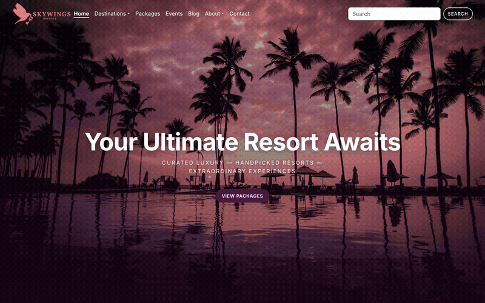
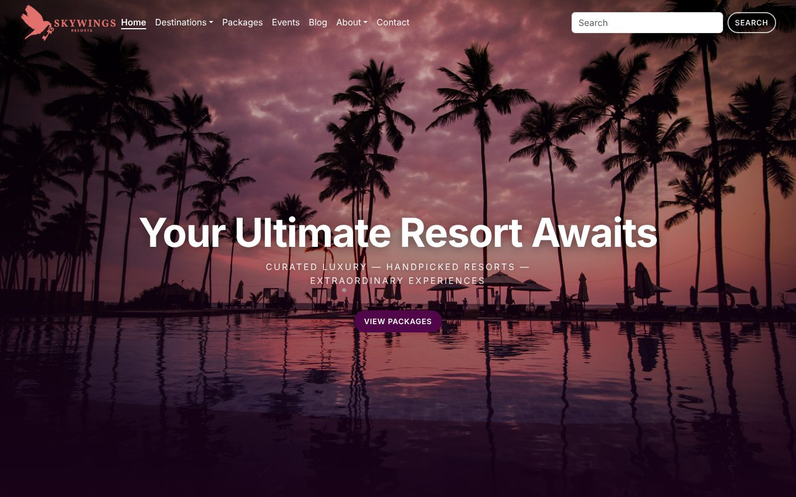
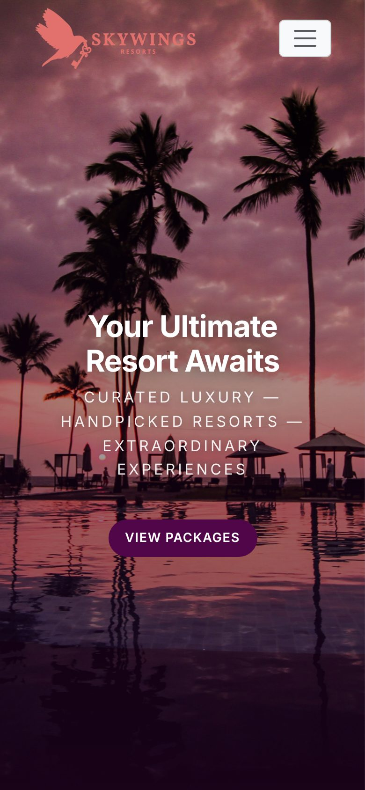

# Skywings Resorts (Bootstrap clone)

> A multi-page luxury-resort travel site built with Bootstrap: destinations, packages, events, blog, team and contact.

**Get it:** download it with the VS Code commands in the [hub README](https://github.com/thedalycreative/eqc-activities-hub#bootstrap-clone-sites-get-one-on-your-computer), then open `index.html` with Live Server.

   

## Features

- Full-screen hero with search, navbar with Destinations and About dropdowns
- Destination pages: Australia, Hawaii, New Zealand, Singapore, plus Top Resorts
- Packages, events, blog, gallery, FAQ, team and contact pages
- Custom 404 page
- Responsive Bootstrap grid and carousel

## Tech stack

- HTML5 and Bootstrap 5 with a custom `styles.css`
- Stock photography (Pexels)
- Hosted on Vercel

## Run it locally

```bash
git clone https://github.com/thedalycreative/eqc-activities-hub.git && cd eqc-activities-hub/bootstrap-clone-skywings

npx serve .
```

## Deployment (Vercel)

Static site, this folder is the output. It now lives in the **eqc-activities-hub** repo, but it isn't published on the live hub (copies of real brands got the hub flagged by Google); students download it instead. (Previously deployed by CLI as `skywings-activity`; source recovered from that deployment. The original student README is kept as `NOTES.md`.)

## Screenshots



<p align="center">
  
  
</p>

_Captured from the old live copy. Regenerate with any headless browser; files live in `docs/screenshots/`._

---

Built by [The Daly Creative](https://www.thedalycreative.com) · Perth, WA
