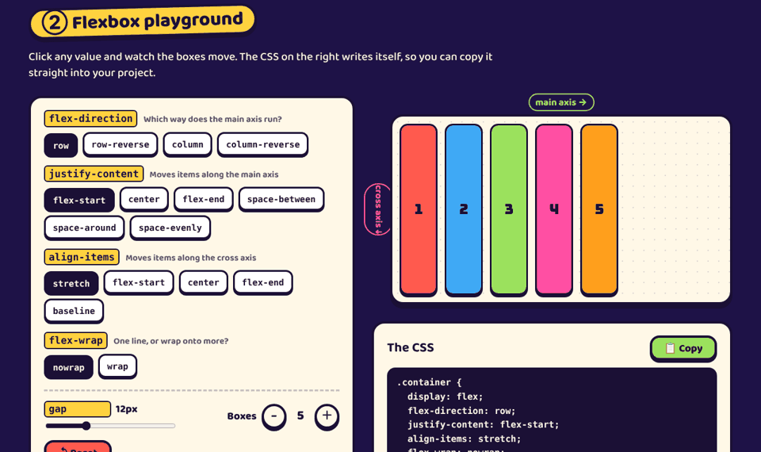
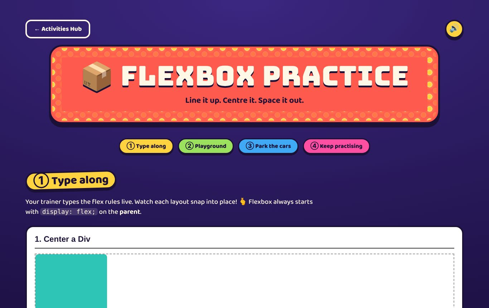
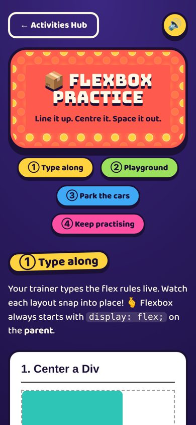

# 📦 Flexbox Practice: EQC Activities Hub

> **Live-code flexbox with the class, play with every property in the playground, then park the cars using nothing but flexbox.**

**Live:** https://eqc-activities-hub.vercel.app/flexbox-exercise/



<p align="center">
  
  
  
  
  
</p>

---

## 📖 Table of Contents

1. [What is this?](#-what-is-this)
2. [Live-typing the exercises (trainers)](#-live-typing-the-exercises-trainers)
3. [What's on the page](#-whats-on-the-page)
4. [Screenshots](#-screenshots)
5. [How it works](#-how-it-works)
6. [Folder map](#-folder-map)
7. [Run it, test it](#-run-it-test-it)
8. [Change it](#-change-it)
9. [Troubleshooting](#-troubleshooting)
10. [Resources](#-resources)

---

## 🎯 What is this?

One page that takes students from "what's flexbox?" to parking cars with it:

| Part | What happens |
|---|---|
| **① Type along** | Three exercises (Center a Div, Navbar, Responsive Card Row). The trainer types the flex rules **live** while students watch the layouts snap into place. |
| **② Playground** | Click any value of `flex-direction`, `justify-content`, `align-items`, `flex-wrap` or `gap`. The boxes move, the **main / cross axis** arrows turn, and the CSS writes itself (with a 📋 Copy button). |
| **③ 🚗 Park the cars** | 10 levels. Each car has a numbered bay; pick the right flexbox values to park them all. Level 10 is a boss. 🏆 |
| **④ Keep practising** | Flexbox Froggy, FLEX by Malven, the CSS-Tricks guide, Flexbox Defense, Knights of the Flexbox Table and Grid Garden. |

---

## 🧑‍🏫 Live-typing the exercises (trainers)

The `<style>` block in [`flexbox_starter.html`](flexbox_starter.html) holds **only** the three exercises, so there's nothing else to scroll past while you type.

1. Open the folder in **VS Code** and start **Live Server** on `flexbox_starter.html`.
2. Show the class the broken layouts first: the teal box is stuck top-left, and the navbar is stacked.
3. Find each `/* 👇 type here */` and type one line at a time, saving after each:

```css
/* 1. CENTER A DIV */
.ex1-container {
  display: flex;            /* the box jumps into a row */
  justify-content: center;  /* centre on the main axis → */
  align-items: center;      /* centre on the cross axis ↓ */
}

/* 2. NAVBAR */
.navbar {
  display: flex;
  justify-content: space-between; /* logo left, links right */
  align-items: center;
}
.navbar .links {
  display: flex;
  gap: 16px;                /* space without margins */
}
```

4. Exercise 3 already uses flexbox. Use its dropdowns to show `flex-direction`, `justify-content` and `align-items` live.

> **Tip:** before the next class, delete what you typed (or `git checkout flexbox_starter.html`) so exercises 1 and 2 start broken again.

---

## 📸 Screenshots

<p align="center">
  
  
</p>

---

## 🧩 How it works

All the flexbox facts live once in [`flex-logic.js`](flex-logic.js): every property, every value with a one-line explanation, and the 10 parking levels:

```js
{
  cars: 2, props: ['justify-content', 'align-items'],
  target: { 'justify-content': 'center', 'align-items': 'center' },
  task: 'Dead centre. Yes, this is “centre a div”!',
  tip: 'You need both: one for each axis.',
}
```

The game draws the **bays** with the target values and the **cars** with the player's values, in two flex containers stacked on top of each other. A level is won when every car sits on its bay:

```js
c.every((r, i) => Math.abs(r.left - b[i].left) < 2 && Math.abs(r.top - b[i].top) < 2)
```

It compares **positions**, not answers, so any combination of values that parks the cars counts. That's how real CSS works too.

- [`flexbox-lab.js`](flexbox-lab.js) runs the playground, the game and exercise 3's dropdowns.
- The look comes from the hub's [`assets/hub.css`](../assets/hub.css) plus [`flexbox-lab.css`](flexbox-lab.css).
- Exercise 3's items are called `.flex-card`, not `.card`, because `hub.css` already styles `.card`.

---

## 📁 Folder map

```
flexbox-exercise/
├── flexbox_starter.html  ← The page. Its <style> block = the live-typing exercises only
├── flexbox-lab.css       ← The page around the exercises (playground, game, tiles)
├── flex-logic.js         ← Properties, explanations and the 10 levels (no page code)
├── flexbox-lab.js        ← Playground, Park the cars, exercise 3 dropdowns
├── favicon.svg, favicon-32.png, favicon.ico, apple-touch-icon.png
├── README.md             ← This file
└── docs/screenshots/     ← demo.gif, desktop.jpg, mobile.jpg
```

---

## ⚡ Run it, test it

```bash
# from the repo root
npx serve .            # then open http://localhost:3000/flexbox-exercise/
sh tests/run-all.sh    # every test in the hub
```

| Test file | Checks |
|---|---|
| `tests/unit/flex-logic.test.mjs` | Every value is explained, CSS output, axis arrows, every level offers the properties it needs and doesn't start solved |
| `tests/e2e/test_flexbox.py` | Hub look and back link, exercises 1–2 start without flexbox, the playground updates the CSS, **all 10 levels can be won**, progress is saved |

---

## 🔧 Change it

- **Add a parking level:** add an object to `LEVELS` in `flex-logic.js` (up to 3 cars). The unit tests check it can be solved.
- **Add a playground value:** add it to that property's `values` in `PROPS`, with a one-line explanation.
- **Reset the class's progress:** levels are remembered in the browser (`localStorage` key `eqc-flex-parking`). Clear site data to start over.

---

## 🛟 Troubleshooting

<details>
<summary><strong>The page has no colours or fonts</strong></summary>

It borrows its look from `../assets/hub.css`, so open it from inside the whole repo (or the live site). The exercises still work without it.
</details>

<details>
<summary><strong>The playground and the game are empty</strong></summary>

They're JavaScript modules, which don't run from a double-clicked file. Use Live Server or `npx serve .` from the repo root.
</details>

<details>
<summary><strong>Exercise 1 is already centred before I've typed anything</strong></summary>

Someone saved the typed version. Delete the `display: flex` lines under `👇 type here` (or `git checkout flexbox_starter.html`).
</details>

---

## 🔗 Resources

- 🐸 [Flexbox Froggy](https://flexboxfroggy.com/): the classic flexbox game
- 🗺️ [FLEX by Malven](https://flexbox.malven.co/): visual cheatsheet, click to copy
- 📖 [A Complete Guide to Flexbox](https://css-tricks.com/snippets/css/a-guide-to-flexbox/) (CSS-Tricks)
- 🏰 [Flexbox Defense](http://www.flexboxdefense.com/) · 🛡️ [Knights of the Flexbox Table](https://knightsoftheflexboxtable.com/) · 🥕 [Grid Garden](https://cssgridgarden.com/)

---

**Line it up. Centre it. Space it out.** 📦✨

Made by [Tim Daly](https://thedalycreative.com) for EQC classes
