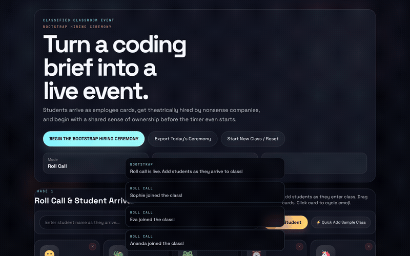
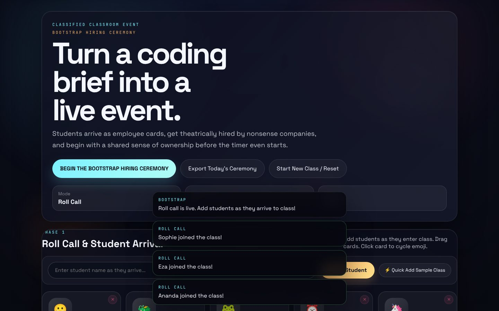
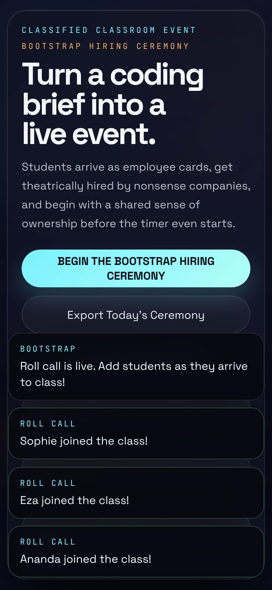

# EQC Hiring Generator

> The Bootstrap Hiring Ceremony: a theatrical classroom tool that turns assigning students to Bootstrap projects into a live event. 🚧 Flagged for an update.

**Live demo:** [eqc-activities-hub.vercel.app/hiring-generator/](https://eqc-activities-hub.vercel.app/hiring-generator/)

   

## Features

- Roll call: students arrive as animated employee cards (add as they walk in, or Quick Add a sample class)
- Movie-trailer style company reveal and a random picker that never repeats a student
- Winners leave the pool and their history stacks up as small draggable windows
- Hidden teacher hotkeys for extra spectacle, sound cues and a closing countdown
- Export the day's ceremony as a report; start a fresh class with one click
- `PROMPT.md` holds the full build brief

## Tech stack

- Plain HTML, CSS and vanilla JavaScript, no build step
- Space Grotesk + JetBrains Mono
- Hosted on Vercel

## Run it locally

```bash
git clone https://github.com/thedalycreative/eqc-activities-hub.git && cd eqc-activities-hub/hiring-generator

npx serve .        # or open index.html
```

## Deployment (Vercel)

Static site, this folder is the output. It now lives in the **eqc-activities-hub** repo, whose Vercel project deploys `main` to **https://eqc-activities-hub.vercel.app/hiring-generator/**. (Previously deployed by CLI as the `webdev-bootstrap` project; source recovered from that deployment.)

## Screenshots



<p align="center">
  
  
</p>

_Captured from the live site (https://eqc-activities-hub.vercel.app/hiring-generator/). Regenerate with any headless browser; files live in `docs/screenshots/`._

> **To do:** flagged for an update.

---

Built by [The Daly Creative](https://www.thedalycreative.com) · Perth, WA
