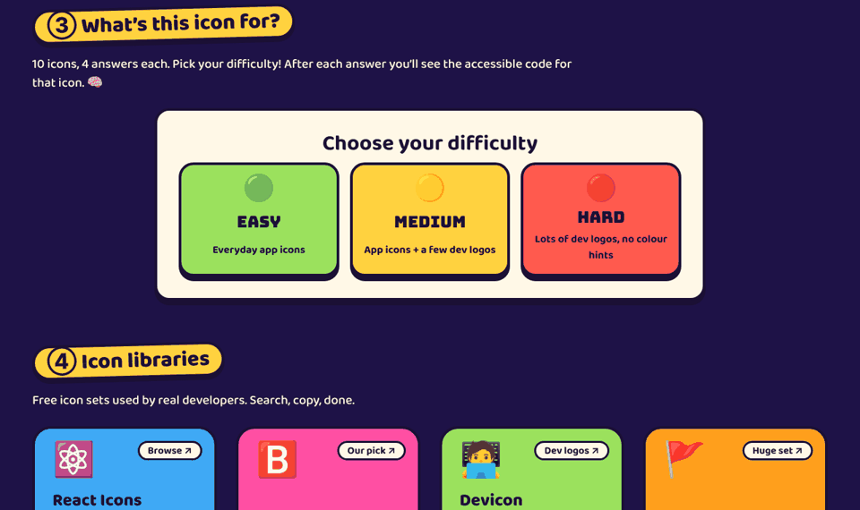
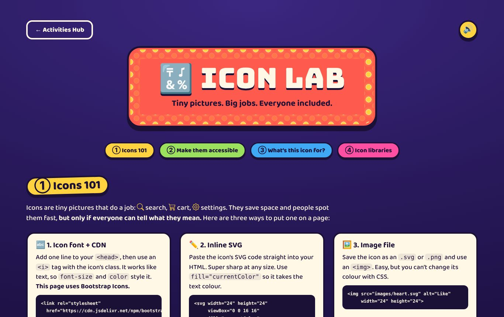
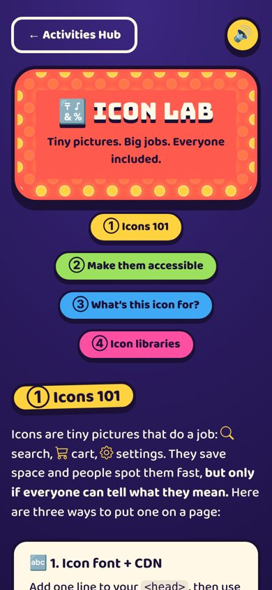

# 🔣 Icon Lab: EQC Activities Hub

> **How to put icons on a page, how to make them work for everyone (screen readers, fingers, low vision), and a "What's this icon for?" game with three difficulty levels.**

**Live:** https://eqc-activities-hub.vercel.app/icon-lab/



<p align="center">
  
  
  
  
  
  
</p>

---

## 📖 Table of Contents

1. [What is this?](#-what-is-this)
2. [The accessibility rules it teaches](#-the-accessibility-rules-it-teaches)
3. [The game](#-the-game)
4. [Screenshots](#-screenshots)
5. [How it works](#-how-it-works)
6. [Folder map](#-folder-map)
7. [Run it, test it](#-run-it-test-it)
8. [Change it](#-change-it)
9. [Troubleshooting](#-troubleshooting)
10. [Resources](#-resources)

---

## 🎯 What is this?

| Part | What's in it |
|---|---|
| **① Icons 101** | Three ways to add an icon (icon font + CDN, inline SVG, image file), then the **🎛️ Icon tinkerer**: pick an icon, size and colour, and it measures the real **tap area** and **contrast**, and writes the accessible HTML |
| **② Make them accessible** | Six rule cards, then **🔊 What does a screen reader hear?** Five versions of the same search button, each with a **Hear it** button that reads it out with the browser's voice |
| **③ What's this icon for?** | 10 icons, 4 answers each, Easy / Medium / Hard. After every answer it shows the accessible code for that icon |
| **④ Icon libraries** | React Icons, Bootstrap Icons, Devicon, Font Awesome, Material Symbols, Lucide, plus accessibility reading |

---

## ♿ The accessibility rules it teaches

| Situation | Do this |
|---|---|
| Icon next to visible text | `aria-hidden="true"` on the icon so it isn't read twice |
| Icon-only button | `aria-label` on the **button**, naming the **action** ("Close", not "X icon") |
| Icon-only button, another way | `<span class="visually-hidden">Search</span>` inside the button |
| Icon that means something on its own | `role="img"` + `aria-label` |
| Tap size | At least **24×24px** (WCAG 2.2 AA), **44×44px** is better |
| Contrast | At least **3:1** against the background (WCAG 1.4.11) |

---

## 🎮 The game

| Level | 10 rounds made of |
|---|---|
| 🟢 **Easy** | 10 everyday app icons (search, cart, settings…) |
| 🟡 **Medium** | 7 app icons + 3 well-known dev logos (HTML, CSS, GitHub…), in colour |
| 🔴 **Hard** | 4 app icons + 6 dev logos (incl. Node.js, Sass, Docker…), **no colour hints** |

- Wrong answers are always the same kind of icon, so there are no giveaways.
- Keyboard: **1–4** to answer, **Enter** for the next icon.
- Score, 🔥 streaks, best score per level (saved in the browser), confetti at 8/10 or more, and a "Ones to remember" list of missed icons.
- The icon itself is hidden from screen readers **on purpose**. Otherwise it would read out the answer!

---

## 📸 Screenshots

<p align="center">
  
  
</p>

---

## 🧩 How it works

The icons load from a CDN with **Subresource Integrity**, so the browser refuses a file that's been tampered with:

```html
<link rel="stylesheet" href="https://cdn.jsdelivr.net/npm/bootstrap-icons@1.13.2/font/bootstrap-icons.min.css"
  integrity="sha384-nWN3KqaaVcbEsCjLSV+2jMjh62Iny/+mN3srM8TZeM8N6aj7eDl5wwYggjAJ4/sJ" crossorigin="anonymous">
```

Every icon in the game lives once in [`icon-logic.js`](icon-logic.js), with what it's **for** and its accessible label:

```js
ui('gear', 'Settings', 'Open settings')          // label shown in the game, aria-label in the code tip
dev('github-original', 'GitHub')
```

- `buildGame(difficulty)` picks the icons and three same-kind wrong answers, then shuffles. The random function can be swapped, so the tests are repeatable.
- `contrastRatio()` and `targetVerdict()` are the WCAG maths behind the tinkerer. It measures the **real** button with `getBoundingClientRect()`.
- [`icon-page.js`](icon-page.js) draws everything and runs the game; sounds come from the hub's [`assets/sound.js`](../assets/sound.js).

---

## 📁 Folder map

```
icon-lab/
├── index.html      ← The page (CDN links for Bootstrap Icons + Devicon)
├── style.css       ← This page's layout (look comes from ../assets/hub.css)
├── icon-logic.js   ← Icon lists, buildGame(), contrast + tap-size maths (no page code)
├── icon-page.js    ← Tinkerer, screen reader demo, the game
├── favicon.svg
├── README.md       ← This file
└── docs/screenshots/  ← demo.gif, desktop.jpg, mobile.jpg
```

---

## ⚡ Run it, test it

```bash
# from the repo root
npx serve .            # then open http://localhost:3000/icon-lab/
sh tests/run-all.sh    # every test in the hub
```

| Test file | Checks |
|---|---|
| `tests/unit/icon-logic.test.mjs` | Unique labels, every difficulty's mix over 50 seeded games, 4 different answers of the same kind, the WCAG contrast and tap-size maths |
| `tests/e2e/test_icon_lab.py` | Hub look, CDN links carry `integrity`, tinkerer verdicts, screen reader demo, a perfect Easy game, a 0/10 Medium game, Hard has 6 uncoloured dev logos, keyboard answers |

---

## 🔧 Change it

- **Add an icon to the game:** add a `ui('icon-name', 'What it is for')` line to `UI_ICONS` (names from [icons.getbootstrap.com](https://icons.getbootstrap.com/)), or a `dev('name-plain', 'Name')` line to `DEV_EASY` / `DEV_HARD` (names from [devicon.dev](https://devicon.dev/)).
- **Change the mix:** edit `DIFFICULTIES` (`ui`, `devEasy`, `devHard` must add up to 10).
- **Update a CDN version:** change the URL **and** the `integrity` hash. Get the hash from jsdelivr's "Copy HTML + SRI" button.

---

## 🛟 Troubleshooting

<details>
<summary><strong>The icons are blank squares or missing</strong></summary>

The icon fonts come from cdn.jsdelivr.net. Check you're online. If you changed a CDN version, the `integrity` hash must match the new file or the browser blocks it.
</details>

<details>
<summary><strong>"Hear it" doesn't talk</strong></summary>

It uses your browser's built-in voice (`speechSynthesis`). If there isn't one, it shows the words in a pop-up instead. Real screen readers like NVDA or VoiceOver sound a little different.
</details>

---

## 🔗 Resources

- ⚛️ [React Icons](https://react-icons.github.io/react-icons/icons/di/) · 🅱️ [Bootstrap Icons](https://icons.getbootstrap.com/) · 🧑‍💻 [Devicon](https://devicon.dev/) · 🚩 [Font Awesome](https://fontawesome.com/icons) · 🔷 [Material Symbols](https://fonts.google.com/icons) · ✨ [Lucide](https://lucide.dev/)
- 🏷️ [Accessible Icon Buttons](https://www.sarasoueidan.com/blog/accessible-icon-buttons/) (Sara Soueidan)
- 👆 [WCAG 2.5.8 Target Size (Minimum)](https://www.w3.org/WAI/WCAG22/Understanding/target-size-minimum.html) · 🌗 [WCAG 1.4.11 Non-text Contrast](https://www.w3.org/WAI/WCAG22/Understanding/non-text-contrast)
- 🎨 [WebAIM contrast checker](https://webaim.org/resources/contrastchecker/)

---

**Tiny pictures. Big jobs. Everyone included.** 🔣✨

Made by [Tim Daly](https://thedalycreative.com) for EQC classes
