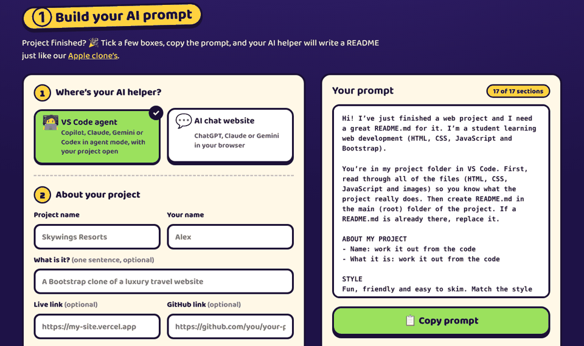
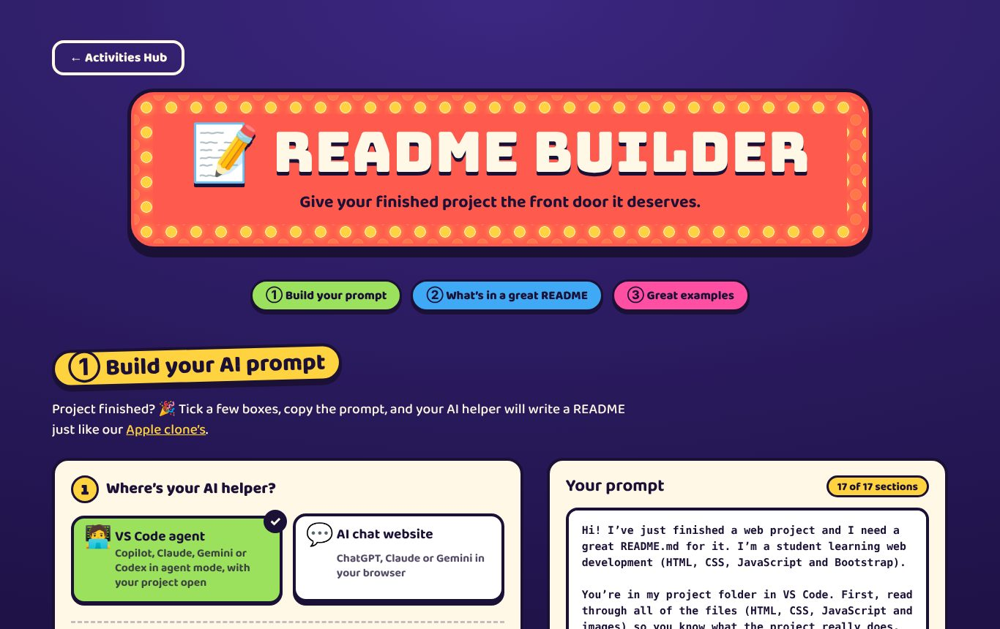
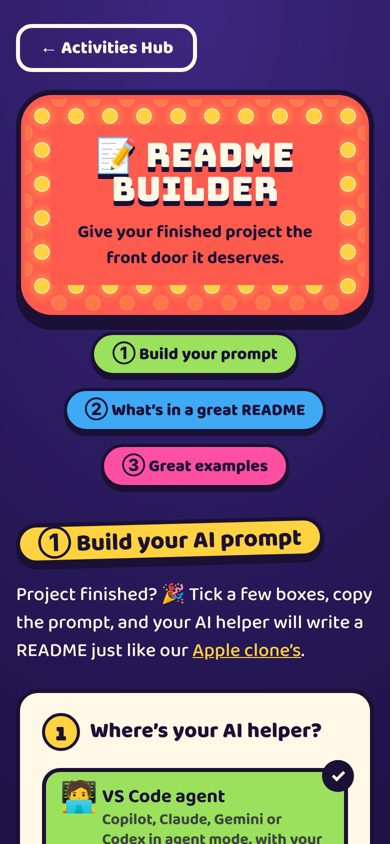

# 📝 README Builder: EQC Activities Hub

> **Tick a checklist, copy one prompt, and let your AI helper write a README just like our Apple clone's.**
> Underneath: a card-by-card guide to what goes in a great README, plus the best examples on GitHub.

**Live:** https://eqc-activities-hub.vercel.app/readme-builder/



<p align="center">
  
  
  
  
  
</p>

---

## 📖 Table of Contents

1. [What is this?](#-what-is-this)
2. [How to use it (students)](#-how-to-use-it-students)
3. [What's on the page](#-whats-on-the-page)
4. [Screenshots](#-screenshots)
5. [How it works](#-how-it-works)
6. [Folder map](#-folder-map)
7. [Run it, test it](#-run-it-test-it)
8. [Change it](#-change-it)
9. [Troubleshooting](#-troubleshooting)
10. [Resources](#-resources)

---

## 🎯 What is this?

Students finish a project, then stare at an empty `README.md`. This page fixes that.

They answer four quick questions (no tech talk), and it writes an AI prompt for them. They paste it into **VS Code's agent** (Copilot, Claude, Gemini, Codex) or a **chat website** (ChatGPT, Claude, Gemini), and out comes a README in the same style as our [🍏 Apple clone README](../bootstrap-clone-apple/README.MD).

The prompt changes depending on where the AI lives:

| Student picks | The prompt says |
|---|---|
| 🧑‍💻 **VS Code agent** | "You're in my project folder. Read the files, then **create README.md** in the root." |
| 💬 **Chat website** + GitHub link | "Here's my **GitHub repo**. Read it, then give me README.md in one code block." |
| 💬 **Chat website**, no link | "I'll **attach my files**. Read them, then give me README.md in one code block." |

---

## 🎓 How to use it (students)

1. **Finish your project first.** The AI can only describe what's actually there.
2. Open **[/readme-builder/](https://eqc-activities-hub.vercel.app/readme-builder/)** (or the 📝 tile on the hub).
3. Pick where your AI helper is, type your project name, and tick what you want: GIFs, screenshots, the story, tech used…
4. Pick a vibe: 🎉 **Fun** (like the Apple clone) or 🧼 **Clean** (like the hub README).
5. Hit **📋 Copy prompt** and paste it into your AI.
6. Read what it wrote, fix every `TODO`, add your screenshots, then commit and push.

The page remembers your choices on that computer, so you can come back to it.

---

## 📑 What's on the page

| Part | What it does |
|---|---|
| **① Build your AI prompt** | A four-step form on the left, a live prompt on the right that updates as you tick, and a copy button with confetti 🎉 |
| **② What's in a great README** | 17 anatomy cards: ⭐ 5 must-haves and 🚀 12 level-ups. Each one has *what*, *why*, a tiny Markdown example and a **See it ↗** link to that exact part of the Apple README |
| **③ Great reference READMEs** | Our two READMEs plus the six below, each tile showing its web address, then handy tools (badges, GIF recorders, Markdown guides) |

**The six reference READMEs on the page:**

- 📝 [READMINE](https://github.com/mhucka/readmine): an annotated example
- 🏆 [Best-README-Template](https://github.com/othneildrew/Best-README-Template)
- 🌟 [Awesome README](https://github.com/matiassingers/awesome-readme)
- 🛠 [Make a README](https://www.makeareadme.com/)
- 🧱 [readme.so](https://readme.so/)
- 💌 [Art of README](https://github.com/hackergrrl/art-of-readme)

---

## 📸 Screenshots

<p align="center">
  
  
</p>

---

## 🧩 How it works

Every README section lives **once**, in `SECTIONS` inside [`readme-logic.js`](readme-logic.js). The checklist, the anatomy cards and the prompt are all built from that one list:

```js
{
  id: 'gifs', emoji: '🎞️', name: 'GIFs & animations', tier: 'level',
  what: 'A few GIFs that show things moving, or just keep it fun.',
  why: 'A three-second GIF beats three paragraphs…',
  md: '',   // the card's example
  see: { href: '…/README.MD#-the-12-column-grid', label: 'See the animated grid' },
  ask: s => s.where === 'agent' ? 'GIFs: … make animated SVGs yourself …' : 'GIFs: … placeholder paths …',
}
```

- `buildPrompt(state)` is a plain function (no page code), so the unit tests check every option in Node.
- [`readme-page.js`](readme-page.js) draws the page from `SECTIONS`, reads the form, and copies the prompt.
- The look comes from the hub's shared [`assets/hub.css`](../assets/hub.css); [`style.css`](style.css) only adds this page's layout.

---

## 📁 Folder map

```
readme-builder/
├── index.html        ← The page: form, prompt, card and example slots
├── style.css         ← Layout for this page only (colours/fonts come from ../assets/hub.css)
├── readme-logic.js   ← SECTIONS + buildPrompt(): the brains, no page code
├── readme-page.js    ← Draws the checklist and cards, keeps the prompt in sync, copy button
├── favicon.svg       ← The yellow ".md" tab icon
├── README.md         ← This file
└── docs/screenshots/ ← demo.gif, desktop.jpg, mobile.jpg for this README
```

---

## ⚡ Run it, test it

```bash
# from the repo root
npx serve .            # then open http://localhost:3000/readme-builder/
sh tests/run-all.sh    # every test in the hub, including this page's
```

| Test file | Checks |
|---|---|
| `tests/unit/readme-logic.test.mjs` | The prompt wording for each "where", vibe and checklist choice; odd input is cleaned up |
| `tests/e2e/test_readme_builder.py` | The page loads with the hub look, ticking boxes changes the prompt, copy works, choices are remembered, the hub tile links here |

---

## 🔧 Change it

- **Add a README section:** add one object to `SECTIONS` in `readme-logic.js`. It shows up in the checklist, the cards and the prompt automatically.
- **Change the must-haves:** set `tier: 'must'` or `'level'`. "Just the must-haves" ticks the `must` ones.
- **Swap the example links:** they're plain `<a class="tile">` tiles in section ③ of `index.html`.

---

## 🛟 Troubleshooting

<details>
<summary><strong>The Copy button says it couldn't copy</strong></summary>

Some browsers block copying on pages opened straight from a file. Click inside the prompt box, press <kbd>Ctrl</kbd>+<kbd>A</kbd> then <kbd>Ctrl</kbd>+<kbd>C</kbd> (<kbd>⌘</kbd> on a Mac), or run the page through Live Server.
</details>

<details>
<summary><strong>The checklist and cards are empty</strong></summary>

They're drawn by JavaScript modules, which don't run from a double-clicked file. Use `npx serve .` or Live Server from the repo root (the page needs `../assets/hub.js`).
</details>

<details>
<summary><strong>The AI made things up</strong></summary>

The prompt tells it to write `TODO` instead of guessing, but AI still slips. Check every link, number and feature before you push.
</details>

---

## 🔗 Resources

- 🍏 [Apple clone README](../bootstrap-clone-apple/README.MD): the style the prompt asks for
- 📝 [READMINE](https://github.com/mhucka/readmine): an annotated example README
- 🛡️ [Shields.io](https://shields.io/): the badges above
- 📄 [Markdown cheat sheet](https://www.markdownguide.org/cheat-sheet/)
- 📘 [GitHub's README guide](https://docs.github.com/en/repositories/managing-your-repositorys-settings-and-features/customizing-your-repository/about-readmes)

---

**Every great project deserves a great front door.** 🚪✨

Made by [Tim Daly](https://thedalycreative.com) for EQC classes
